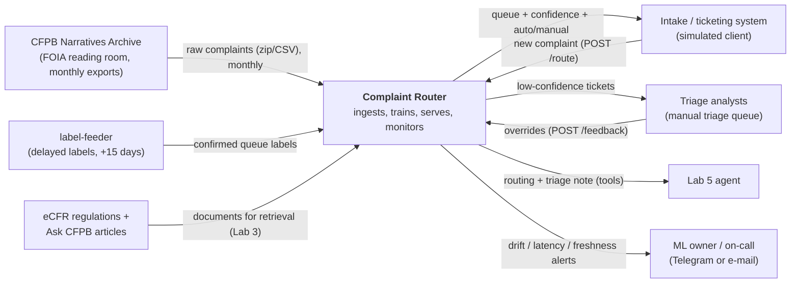
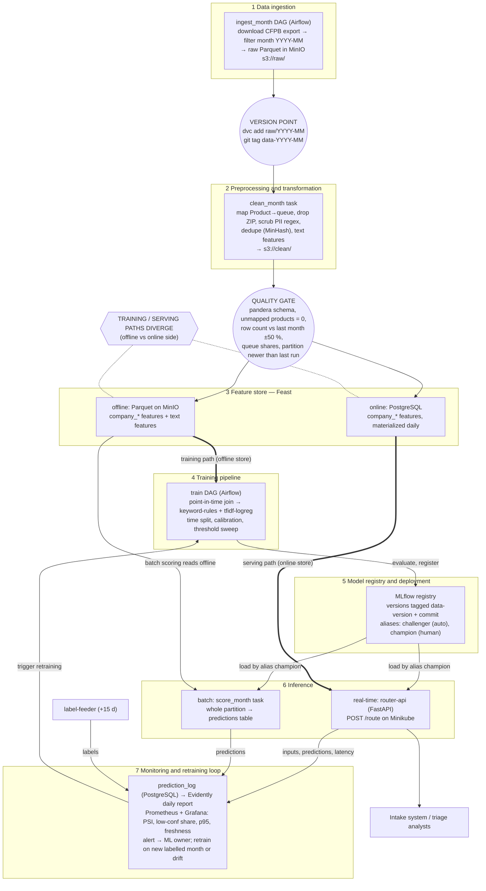
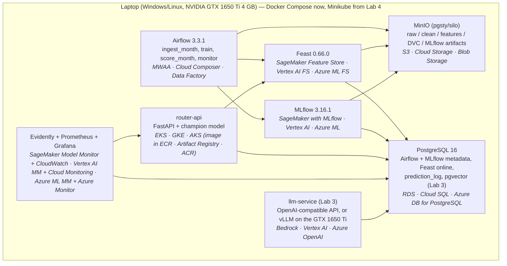

# Complaint Router — Design Document

**Author:** Yuliia Martynova · **Course:** KSE Introduction to MLOps and ML System Design · **Status:** Lab 1 (design), v0.1 · **Date:** 2026-10-19

> Convention used throughout: a statement marked **Assumption:** is a number or decision I proceed with until a later lab measures it. Sections that later labs revise say so in their first line. Component names (in `code` style) are the same in the text, in §6.2 and in all three diagrams.

---

## 1 Overview

Financial-services companies receive consumer complaints as free text and have to send each one to the product team that can resolve it; done by hand, this triage is slow and inconsistent, and a misrouted complaint loses days while it bounces between teams. **Complaint Router** is a service that reads a complaint at intake and returns the product queue it belongs to (one of nine), with a confidence score, so confident cases are routed automatically and uncertain ones go to a human triage desk. It is trained on the CFPB Consumer Complaint Database archive (consumer narratives with the product the complaint was filed under, December 2011 – August 2026), retrained on each new monthly batch, and monitored for drift in the language and mix of complaints. The desired outcome is that most complaints reach the right team without a human touching them, and that a shift in what people complain about is noticed by a person before routing quality quietly degrades.

## 2 Motivation

**Why a system and not a notebook.** A notebook can show that a classifier separates complaint narratives by product once. The routing problem is not static: complaint mix and vocabulary change every month (credit reporting grew to ≈ 88 % of all CFPB complaints in 2025; among published narratives its share was 75 % over 2023–2025 (58–81 % in every month from September 2024 to December 2025) and then fell to ≈ 4 % from January 2026, when narrative volume also dropped from 56–173 k to 10–22 k per month; new scam patterns appear, product taxonomies get renamed), so the model must be retrained on new periods, compared with the model in production, promoted under control, and watched while it serves. That is a pipeline, a registry, a service and a monitor — not a notebook.

**Who consumes the predictions.**
- *Primary consumer:* the intake / ticketing system of a complaint-handling desk (simulated in this course by a client script and, in Lab 5, by an agent). It calls `router-api` once per new complaint at submission time and uses the returned queue to place the ticket.
- *Secondary consumer:* triage analysts, who see the predicted queue and the confidence on low-confidence tickets in the manual triage queue and confirm or correct them.

**How often.** **Assumption:** traffic shaped like the CFPB's own intake volume in 2026 — 497 000–672 000 complaints per month in January–August 2026 (≈ 600 000 on average, counted in the archive, all rows with or without narrative), i.e. ≈ 20 000 per day, ≈ 0.23 requests/s on average, with a 10× peak during business hours. The course demo runs at a fraction of this; the design budgets for 10 requests/s.

**What happens when predictions are wrong.**
- *Wrong queue, high confidence:* the ticket lands with a team that cannot resolve it, is reassigned by hand, and the consumer's response clock (the CFPB expects a company response within 15 days) keeps running. This is the costly error, so the confidence threshold is tuned against it (§3, §5.4).
- *Low confidence:* the ticket goes to the manual triage queue — slower, but safe. This is the designed fallback.
- *Service unavailable:* the intake system routes everything to the manual triage queue (§4, availability row). Nothing is lost; only the automation rate drops.

## 3 Success metrics

Three layers, kept apart. Optimizing vs satisficing is stated per metric.

| Layer | Metric | Target | Type | Status |
|---|---|---|---|---|
| **Business / decision** | *Automation rate at safe precision*: share of complaints routed automatically (confidence ≥ threshold) while the misrouting rate among auto-routed complaints stays ≤ 5 % | ≥ 70 % auto-routed | Optimizing (the threshold is chosen to maximize it under the 5 % constraint) | **Assumption:** targets set from intuition about a triage desk; no real desk to measure against. Measured offline on the held-out period in Lab 2 and on delayed labels in Lab 4. |
| **Business / decision** (secondary) | Manual triage hours saved per month = auto-routed tickets × 2 min | reported, no target | Reported | **Assumption:** 2 minutes of analyst time per manual routing decision. |
| **Model** | Macro-F1 over the 9 queues on the time-held-out period | ≥ 0.75, and ≥ baseline + 0.15 | Satisficing (gate for promotion, §5.4) | **Assumption:** 0.75 is a guess until the Lab 2 baseline is measured; the "≥ baseline + 0.15" part is the real gate. |
| **Model** (guard) | Per-queue recall | no queue below 0.55 | Satisficing | Protects small queues (e.g. student loans) from being sacrificed to the dominant credit-reporting class. |
| **System** | p95 latency of `POST /route`, measured at the service | ≤ 300 ms | Satisficing | **Assumption:** budget chosen so a web intake form can call it synchronously. |
| **System** | Availability of `router-api` during the demo window | ≥ 99 % of health checks pass | Satisficing | Lab 4 measures it with probes. |
| **System** | Feature freshness: age of the newest `company_*` features in the online store | ≤ 26 h | Satisficing | Daily materialization + 2 h slack. |

## 4 Requirements and constraints

### Functional requirements

| # | Requirement |
|---|---|
| F1 | **Input:** `POST /route` with JSON `{complaint_id, narrative, company, state, tags, date_received}`; `narrative` is required, 20–20 000 characters (2 387 of the 3.85 M archive narratives, 0.06 %, fall outside this range; such requests get `422` and the caller routes them to manual triage). |
| F2 | **Output:** `{complaint_id, queue, confidence, top3: [{queue, p}], route: "auto" \| "manual", model_version, request_id}`. `route` is `auto` when `confidence ≥ threshold` (threshold stored with the model in the registry). |
| F3 | **Who calls:** the intake system (service account with an API key); the Lab 5 agent with its own key. No anonymous access. |
| F4 | `POST /feedback` `{complaint_id, true_queue, source: "analyst" \| "label_batch"}` records a correction or a delayed label. |
| F5 | `GET /health` (liveness) and `GET /ready` (readiness: model loaded, feature store reachable). |
| F6 | A batch job scores a whole monthly partition (back-fill and monitoring), writing to the `predictions` table. |
| F7 | Every prediction is logged with its inputs' hash, features used, model version and latency (§6.6). |
| F8 | Retraining runs as a scheduled pipeline on each new monthly batch and registers a candidate model; promotion to `champion` needs a human (§5.5). |

### Non-functional requirements (one row per category)

| Category | Requirement | Number or assumption |
|---|---|---|
| **Freshness** | Predictions are computed at request time from the request text (always fresh). Company-level features in the online store are refreshed daily. The model is retrained when a new monthly batch lands. | Online features ≤ 26 h old; model trained on data ≤ 45 days older than the latest batch. **Assumption:** monthly retraining is enough because complaint mix shifts over months, not hours. |
| **Latency and throughput** | Synchronous online inference on CPU. | p95 ≤ 300 ms, p99 ≤ 800 ms at 10 requests/s sustained; batch scoring of one monthly partition (≤ 175 k narrative rows; the largest month is 2025-01 with 172 937, 2026 months have 10–22 k) ≤ 30 min on the laptop. **Assumption:** 10 rps is ≈ 43× the 2026 average and covers a 10× business-hours peak. |
| **Availability and fallback** | If `router-api` is down, times out (> 1 s) or returns 5xx, the caller routes the ticket to the manual triage queue. If the online feature store is unreachable, the service answers using text-only features and marks `degraded: true`. | ≥ 99 % during the demo window. Fallback = manual triage, never "drop". |
| **Reproducibility** | Any registered model is rebuilt from (git commit, DVC data version, config). Environment pinned by `uv.lock`; containers tagged with the commit SHA; random seeds fixed. | One command per model (`make train DATA_VERSION=…`), Lab 2. |
| **Adaptability** | New data enters as a new monthly partition through the ingestion DAG; new models enter as MLflow registry versions with alias `challenger`, compared with `champion` on the latest held-out month; the serving image is not rebuilt to change a model, only the alias. A new queue requires a mapping change in `configs/queues.yaml` and a retrain. | New batch → candidate model within 1 day of landing. |
| **Observability without ground truth** | Labels arrive ≈ 15 days late (§5.2). Until then, monitor input drift (text length, out-of-vocabulary rate, company mix), prediction drift (queue distribution PSI), confidence (mean, share below threshold), analyst override rate, and service metrics. | PSI on predicted-queue distribution > 0.2 or low-confidence share > 30 % over 7 days → alert. Macro-F1 on labelled data computed weekly once labels arrive. |
| **Cost and resource ceilings** | Everything runs locally on one laptop: Minikube with 4 GB RAM, docker driver; GPU NVIDIA GTX 1650 Ti (4 GB VRAM) only for the optional Lab 3 local LLM. Cloud estimate in §6.7. | Training a candidate ≤ 15 min on CPU, ≤ 8 GB RAM; raw data ≤ 10 GB on disk (the full archive is 1.37 GB zipped, 9.3 GB as CSV). The laptop has 32 GB RAM and an Intel i7-10750H (measured); Minikube still gets only 4 GB so the data stack fits beside it. LLM spend ≤ $10/month. |

### 4.1 In scope and out of scope

**In scope**
- Routing a single complaint narrative to one of 9 product queues, online and in batch.
- Monthly retraining on a replay of the CFPB archive, registry with human promotion, drift monitoring, alerts.
- Lab 3: an LLM assistant that, for a routed complaint, retrieves the relevant regulation / CFPB consumer guidance and drafts a triage note with citations.
- Lab 5: an agent that uses the routing API and the retrieval component as tools.

**Out of scope**
- Fine-grained routing to `issue` / `sub-issue` (≈ 80+ values, unstable taxonomy) — possible later, not in this course.
- Predicting the company's response, relief or dispute outcome.
- Any real consumer-facing product, real ticketing system integration, or real-time streaming ingestion.
- Multi-language complaints (the corpus is English).
- Judging whether a complaint is truthful or fraudulent (we only *detect near-duplicate templates* as a data-quality signal, §6.9).

---

## 5 Methodology

### 5.1 Problem statement

**Framing chosen: single-label multi-class text classification** with a reject option. Input: complaint narrative plus a few intake fields; output: a probability distribution over 9 queues; the top class is used when its probability is above a threshold, otherwise the complaint is rejected to manual triage. The threshold makes the precision/automation trade-off of §3 explicit.

The 9 queues are a consolidation of the CFPB `Product` field, mapped in `configs/queues.yaml` (Lab 2):

| Queue | CFPB products mapped to it (by name pattern) |
|---|---|
| `CREDIT_REPORTING` | Credit reporting… / other personal consumer reports |
| `DEBT_COLLECTION` | Debt collection |
| `BANKING` | Checking or savings account; Bank account or service |
| `CARDS` | Credit card; Prepaid card; Credit card or prepaid card |
| `MORTGAGE` | Mortgage |
| `STUDENT_LOAN` | Student loan |
| `VEHICLE_LOAN` | Vehicle loan or lease |
| `CONSUMER_LOAN` | Payday loan; Payday loan, title loan, or personal loan; Payday loan, title loan, personal loan, or advance loan; Consumer Loan; Debt or credit management |
| `PAYMENTS` | Money transfer, virtual currency, or money service; Money transfers; Virtual currency |

The product strings differ across years because the CFPB renamed categories over time. The archive contains **21 distinct `Product` values** (checked against every file); 20 of them map to a queue by pattern. The remaining one, `Other financial service`, has 292 narratives, all from 2015–2017, outside the training window; it is listed explicitly in a `drop` list of `configs/queues.yaml`. The quality gate fails on any value that is neither mapped nor in the `drop` list.

**Rejected framing: hierarchical classification down to `issue`.** Predicting product and then issue would route more precisely, but the issue taxonomy has dozens of values, many with a few hundred examples, and it changes when the CFPB revises its forms — so labels would be sparse and unstable across the time split, and the evaluation would be dominated by taxonomy changes rather than by model quality. Product-level routing is what a triage desk needs first.

### 5.2 Data

**Source.** CFPB Consumer Complaint Database Narratives Archive (FOIA electronic reading room, consumerfinance.gov). It holds complaints received from 1 December 2011 to 14 August 2026 that were published in the database, as 21 zipped full-record CSV exports (one file per period: multi-month files of 3–77 months up to October 2024, two-month files from November 2024, monthly files from March 2026); 1.37 GB zipped, 9.3 GB unzipped, 17.5 M rows, of which **3 851 415 rows carry a narrative** (measured). Rows without a narrative are present too and are filtered out. On 14 August 2026 the CFPB stopped publishing narratives in the live database, so **the archive is frozen**: no new narratives will appear. Licence: US government public data (public domain).

**Fields used** (CFPB export schema; column names checked against all 21 archive files): `Date received`, `Product` (→ label), `Consumer complaint narrative` (→ text), `Company`, `State`, `Tags`, `Complaint ID`. The archive has 16 columns, identical in all files, and **no `Consumer consent provided?` column**: rows are kept when `Consumer complaint narrative` is non-empty. Dropped: `ZIP code` (privacy, §6.5); `Submitted via` (it is `Web` for all 3.85 M narrative rows, so it carries no signal). Excluded from features because they are not known at intake (leakage): `Sub-product`, `Issue`, `Sub-issue`, `Company response to consumer`, `Company public response`, `Timely response?`, `Consumer disputed?`, `Date sent to company`.

**Arrival pattern.** Real: the CFPB published complaints nightly; a complaint appeared after the company responded or after 15 days, and its narrative after the company's public response or 60 days. In this system: **monthly batches replayed from the archive** — the ingestion DAG treats "now" as a simulated date and ingests the calendar month `YYYY-MM` that has just closed, by `Date received`.

**Labels and their delay.** The label is the product category under which the complaint was filed. In the source the label sits in the same row as the narrative, but in the system being simulated the routing decision is made at intake and the confirmed queue is known only once the responsible team has handled the ticket. **Assumption:** label delay = 15 days after `date_received` (the CFPB's expected company-response window). The label emulator (`label-feeder` task in the ingestion DAG) releases labels for complaints whose `date_received + 15 days` is before the simulated date. Lab 4 monitors with proxies during these 15 days (§4, observability row).

**Serving time vs training time.**

| Available | At serving time (one request) | At training time (archive) |
|---|---|---|
| Narrative, company, state, tags, date | Yes, in the request | Yes |
| Company-level aggregates (complaint counts, product mix) | Yes, from the **online** store, up to 26 h old | Yes, from the **offline** store with a point-in-time join |
| Product label | No (that is the prediction) | Yes |
| Issue, company response, timeliness | No | Yes — **excluded** to prevent leakage |

**Volume and training window.** The archive contains 3 851 415 narratives, 2 645 239 of them received from 2023-01-01. **Assumption:** training uses complaints received from 2023-01-01, stratified-downsampled to at most 300 000 rows per training run so a run fits the laptop; the raw monthly partitions are stored in full.

**Data checklist (step 1 of the lab)**

| Item | Justification |
|---|---|
| **A time axis** | Every row has `Date received` (day precision). Batches are calendar months by `Date received`: the archive spans 177 calendar months (2011-12 → 2026-08), 138 of which contain narratives (2015-03 → 2026-07). Because the archive ended on 2026-08-14, "the next month" is produced by *replaying* the archive with a simulated clock; the cost is that there is no genuinely unseen future, and August 2026 (1 narrative) is dropped. The upside: real drift already exists inside the archive (category renames, and a sharp break in January 2026, when the credit-reporting share of narratives fell from 58–81 % in each month of September 2024 – December 2025 to ≈ 4 %, and monthly narrative volume fell from 56–173 k to 10–22 k), so Lab 4 can replay real shifts as well as injected ones. |
| **Enough history to hold out a period** | Narratives exist from 2015-03-19 to July 2026 (≈ 11.4 years). Training: 2023-01 → 2025-12 (2 523 845 narratives). Validation (model selection, calibration, threshold): 2026-01 → 2026-03 (55 991). **Held-out test period: 2026-04 → 2026-07** (65 402; four full months, never used for any decision before the Lab 2 report). Train and test sit on opposite sides of the January 2026 break (credit reporting is 75.0 % of training narratives, 3.9 % of validation, 4.2 % of test); see §5.4. |
| **Labels with a known arrival delay** | Label = filed product category; in the simulation it arrives **15 days** after the complaint (assumption tied to the 15-day company-response window). Labels for a month are complete 15 days after it closes, which is when the monthly retrain is scheduled. |
| **A text surface or a documented corpus** | The task is text: the narrative is the input. For Lab 3 retrieval the corpus is (1) the CFPB "Ask CFPB" consumer guidance articles and (2) the text of the regulations behind each queue from the eCFR — Regulation V / FCRA (credit reporting), Regulation F (debt collection), Regulation E (electronic transfers, payments), Regulation Z (credit cards, mortgages, loans), Regulation X (mortgage servicing), Regulation DD (deposit accounts). Both are public-domain US government text. |

### 5.3 Techniques

**Baseline (rule):** `keyword-rules` — a hand-written dictionary of 10–20 phrases per queue ("credit report", "collector", "escrow", "Navient", "Zelle", …) scored by matches; ties and zero matches go to the most frequent queue of the training window. It needs no training, is explainable to an analyst, and sets the floor that the model must beat by ≥ 0.15 macro-F1 (§3).

**Candidate:** `tfidf-logreg` — a scikit-learn pipeline: TF-IDF on word 1–2-grams (min_df 5, sublinear tf) + character 3–5-grams on the first 2 000 characters, one-hot categorical features, standardized numeric features → multinomial logistic regression with `class_weight="balanced"`, probabilities calibrated on the validation period (isotonic). Chosen because it trains on CPU in minutes, serves in single-digit milliseconds, and its probabilities can be thresholded. **Assumption:** a fine-tuned DistilBERT (fits the 4 GB GTX 1650 Ti with small batches and fp16) is a later challenger only if `tfidf-logreg` misses the model target.

**Features and their serving-time source**

| Feature | Training-time source | Serving-time source |
|---|---|---|
| `narrative_tfidf` (word + char n-grams) | archive narrative, transformed by the fitted pipeline | request `narrative`, transformed by **the same pipeline object** packaged in the model artifact |
| `narrative_len_chars`, `has_dollar_amount`, `redaction_ratio` (share of `XXXX` tokens) | computed from archive narrative by `features/text.py` | computed from request `narrative` by the **same function**, inside `router-api` |
| `state` (one-hot, 50 states + other) | archive column | request field |
| `tag_older_american`, `tag_servicemember` | archive `Tags` | request `tags` |
| `company_complaints_30d` | Feast **offline** store (Parquet on MinIO), point-in-time join on `company` and `date_received` | Feast **online** store (PostgreSQL), materialized daily by Airflow; up to 26 h old |
| `company_top_queue_share_90d` (share of the company's complaints in its most frequent queue, 90 days, labelled data only) | Feast offline, point-in-time join, using only labels older than 15 days at the event date | Feast online, same definition, materialized daily |
| `company_known` (company present in feature store) | derived at join | derived at lookup; unknown company → defaults + flag |

`company_complaints_30d` and `company_top_queue_share_90d` are the features whose serving source differs from the training source — the place where training–serving skew can enter (§6.1 data-flow diagram, §6.9).

### 5.4 Experimentation and validation

**Split strategy — by time, never random.** Complaints arrive over time and the vocabulary and mix drift; a random split would let the model see the future's vocabulary and the same template complaints on both sides, and the company aggregates would leak labels across the split. Splits: train 2023-01 → 2025-12, validation 2026-01 → 2026-03, test 2026-04 → 2026-07 (§5.2). For robustness, a **rolling-origin backtest**: three folds, each training on everything before month *m* and testing on month *m* (*m* = 2026-01, 2026-02, 2026-03), reported as mean ± spread. Near-duplicate narratives (MinHash similarity > 0.9) are kept in only one side of each split; this matters because 41 % of narratives received from 2023 (1 093 632 of 2 645 239) are exact copies of another narrative (measured).

**The January 2026 break.** The class mix of the archive changes abruptly between training and the later periods: `CREDIT_REPORTING` is 75.0 % of training narratives but 3.9 % of validation and 4.2 % of test (measured; the archive does not document the cause). Three consequences for validation: probabilities are calibrated and the auto-routing threshold is chosen on the validation period, which lies after the break; macro-F1 and per-queue recall, not accuracy, are the gates, because they do not reward predicting the formerly dominant class; and the champion/challenger comparison always uses the most recent labelled month, never the training period.

**Offline metrics.** Primary: macro-F1 over the 9 queues. Secondary: per-queue recall, weighted F1, and the **automation rate at ≤ 5 % misrouting** obtained by sweeping the threshold on validation and applying it unchanged to test — the offline estimate of the business metric.

**Comparing a new model with the current one.** Each retrain registers a version with alias `challenger`. A comparison task evaluates `champion` and `challenger` on the same most-recent labelled month and logs both to MLflow. The challenger is eligible for promotion when: macro-F1 ≥ champion − 0.005 *and* automation rate at ≤ 5 % misrouting ≥ champion's; no queue's recall drops by more than 3 percentage points; p95 latency in a local load test ≤ 300 ms. From Lab 4 on, an eligible challenger first runs in **shadow mode** for 7 days (scores logged, not returned) before a human promotes it (§5.5).

### 5.5 Human in the loop

| Event | Who | What they do |
|---|---|---|
| Drift alert (§6.6) | ML owner (me, the on-call for this project) | Within 1 business day: open the Evidently report linked in the alert, decide among "expected seasonal change", "data problem → fix ingestion" or "real shift → trigger retrain"; record the decision in the alert ticket. |
| Model promotion | ML owner | Reviews the champion/challenger comparison run in MLflow and the shadow-mode report; moves the alias `champion` to the new version by hand. The pipeline can set `challenger`, never `champion`. |
| Rollback | ML owner | Moves `champion` back to the previous version; `router-api` reloads on alias change within 5 min. |
| Prediction override | Triage analyst | In the manual triage queue, sees predicted queue + top-3 + confidence, confirms or picks another queue; the choice is sent to `POST /feedback` with `source: analyst`. Overrides become labels for the next retrain and feed the override-rate metric. |
| Threshold change | ML owner, with the triage desk lead (assumed role) | Changing the auto-routing threshold changes workload for the desk, so it is agreed with the desk and stored as a model-version parameter. |

---

## 6 Implementation

### 6.1 High-level design

#### System context

*The system is one box; everything outside it belongs to someone else. `label-feeder` is drawn outside because it stands in for the label source (the team that resolved the ticket); in this course it is an Airflow task that releases archive labels with a 15-day delay.*

#### Data flow on the seven layers

*The three marks: the **version point** sits between ingestion and preprocessing (each raw monthly partition is a DVC version and a git tag); the **quality gate** sits between preprocessing and the feature store (a failed check stops the DAG, nothing reaches Feast); the **training and serving paths diverge** at the offline and online sides of Feast — training reads point-in-time-correct history from the offline store, `router-api` reads the latest materialized values from the online store, and the batch scorer reads the offline store. Training–serving skew can enter exactly there (stale or differently computed `company_*` values) and in text preprocessing if `router-api` did not use the same packaged pipeline.*

#### Deployment, first draft

*First draft; Lab 4 replaces it with the real Minikube topology. Cloud equivalents in italics: AWS · GCP · Azure.*

### 6.2 Infra

Local stack (pinned to the course reference versions) and the managed service I would use instead, per component. These are the only components in the system; the same names appear in all three diagrams.

| Component (role) | Local | AWS | GCP | Azure |
|---|---|---|---|---|
| `MinIO` — object storage, data lake (raw/clean/feature Parquet, DVC remote, MLflow artifacts) | `pgsty/silo:RELEASE.2026-09-16T00-00-00Z` | Amazon S3 | Cloud Storage | Blob Storage |
| `DVC` — data versioning, remote on MinIO | DVC 3.67.1 + dvc-s3 3.3.0 | S3 remote | GCS remote | Azure Blob remote |
| `PostgreSQL` — Airflow and MLflow backend, Feast online store, `prediction_log`, `predictions`, later pgvector | PostgreSQL 16 | Amazon RDS for PostgreSQL | Cloud SQL | Azure Database for PostgreSQL |
| `Airflow` — orchestrator (`ingest_month`, `train`, `score_month`, `monitor` DAGs; `label-feeder` task) | Apache Airflow 3.3.1, LocalExecutor | Amazon MWAA | Cloud Composer | Azure Data Factory |
| `MLflow` — experiment tracking and model registry | MLflow 3.16.1, PostgreSQL backend, MinIO artifacts | SageMaker with MLflow | Vertex AI Experiments + Model Registry | Azure ML with MLflow |
| `Feast` — feature store (offline: Parquet on MinIO; online: PostgreSQL) | Feast 0.66.0 | SageMaker Feature Store | Vertex AI Feature Store | Azure ML managed feature store |
| `router-api` — model service: FastAPI + champion model loaded from MLflow by alias, `/route`, `/feedback`, `/health`, `/ready` | container on Docker Compose, on Minikube from Lab 4 | EKS (SageMaker endpoint as managed alternative) | GKE (Vertex AI endpoint) | AKS (Azure ML online endpoint) |
| Container registry for the `router-api` image | Minikube built-in registry | Amazon ECR | Artifact Registry | Azure Container Registry |
| Kubernetes cluster running `router-api` (Lab 4) | Minikube 1.33.1 (Kubernetes 1.30.0, docker driver, 4 GB) | Amazon EKS | GKE | AKS |
| `Evidently` — data and prediction drift reports | Evidently | SageMaker Model Monitor | Vertex AI Model Monitoring | Azure ML model monitoring |
| `Prometheus` + `Grafana` — service metrics, dashboards, alert routing | Prometheus, Grafana | Amazon CloudWatch | Cloud Monitoring | Azure Monitor |
| Vector store for Lab 3 retrieval | pgvector 0.8.7 (`pgvector/pgvector:pg16`) | OpenSearch Serverless vector search | Vertex AI Vector Search | Azure AI Search |
| `llm-service` — LLM inference for Lab 3 | **Assumption:** an OpenAI-compatible hosted API as default; vLLM 0.30.0 with a ≤ 1.5 B-parameter instruct model on the GTX 1650 Ti as the local option | Amazon Bedrock | Vertex AI generative AI | Azure OpenAI |

Libraries that run *inside* these components and therefore have no separate cloud service: scikit-learn (model), pandera (quality-gate checks inside an Airflow task), datasketch (MinHash dedupe), FastAPI + uvicorn (`router-api`).

**Assumption (hardware):** until Lab 4, services run with Docker Compose on the laptop; Minikube gets 4 GB and only `router-api` + monitoring are moved into it, to stay within laptop RAM.

### 6.3 Performance

**Batch vs online — decision: online for routing, batch for back-fill and monitoring.** The consumer needs the queue at the moment a complaint is submitted, so ticket placement cannot wait for a nightly batch: `router-api` scores one complaint per request, synchronously. Batch (`score_month`) re-scores a whole month for back-fill, for champion/challenger comparison and for drift reports, where latency does not matter but completeness does.

| Path | Budget | How it is met |
|---|---|---|
| `POST /route` end-to-end at the service | p95 ≤ 300 ms, p99 ≤ 800 ms | TF-IDF + logistic regression predicts in ~1–10 ms on CPU (**assumption**, measured in Lab 4); Feast online lookup ≤ 30 ms (PostgreSQL, one key); remaining budget for JSON parsing, logging (async) and network. |
| Throughput | 10 requests/s sustained, 1 replica | One uvicorn worker per CPU core; Lab 4 load-tests with locust/hey. |
| Online feature materialization | daily, ≤ 10 min | Only the `company` entity (≈ a few thousand companies). |
| `score_month` batch | ≤ 30 min for ≤ 175 k rows (largest month of narratives: 2025-01, 172 937) | Vectorized `predict_proba` in chunks of 50 k. |
| Retraining (`train` DAG) | ≤ 15 min on CPU, ≤ 8 GB RAM | ≤ 300 k training rows (§5.2), sparse matrices. |
| LLM triage note (Lab 3, asynchronous, not on the routing path) | p95 ≤ 5 s | Called after routing; never blocks `/route`. |

### 6.4 Security

- **Secrets:** locally in a `.env` file excluded by `.gitignore` (template in `.env.example`, no real values in git); from Lab 4 as Kubernetes Secrets; in the cloud column, AWS Secrets Manager / GCP Secret Manager / Azure Key Vault. Secrets: MinIO root credentials, PostgreSQL passwords, router API keys, LLM API key, alert-bot token.
- **Who may call the service:** `POST /route` and `POST /feedback` require an `X-API-Key` header; two keys exist — intake system and Lab 5 agent; `/health` and `/ready` are open inside the cluster only. MLflow, Airflow and Grafana UIs are bound to localhost (no public exposure); only the ML owner promotes models.
- **Supply chain:** dependencies pinned by `uv.lock`; container images pinned by tag (and by digest in Lab 4); CI runs on every push.

### 6.5 Data privacy

- **What personal data the dataset contains:** the CFPB publishes narratives only with the consumer's opt-in consent and removes direct identifiers (names, account numbers, SSNs appear redacted as `XXXX`; 68 % of archive narratives contain at least one `XXXX`). Remaining quasi-identifiers: 5-digit ZIP code, state, tags (*Older American*, *Servicemember*), company, dates, and free text that may still contain identifying details the redaction missed.
- **What we do:** drop `ZIP code` at preprocessing; run a regex scrubber for e-mails, phone numbers, long digit strings and URLs before text reaches the clean layer; keep `state` and tags (needed as features); log the request narrative only as a hash plus length in `prediction_log`, not as text.
- **Retention:** raw archive partitions are kept for the duration of the course plus the defense, **until 2027-02-28**, then deleted from MinIO and the DVC remote; the clean and feature layers follow the raw data. Prediction logs are kept 90 days.
- **Usage:** the data is public-domain government data used for coursework; the unverified, one-sided nature of narratives (the reason the CFPB gave for ending publication) is acknowledged — the system routes complaints, it does not judge companies.

### 6.6 Monitoring and alarms

*First draft; Lab 4 implements it.*

**What is logged (per request, `prediction_log` in PostgreSQL):** `request_id`, timestamp, simulated date, `complaint_id`, narrative hash and length, all feature values used, `degraded` flag, model version and alias, predicted queue, top-3 probabilities, route (`auto`/`manual`), latency. Later joined with labels from `label-feeder` and overrides from `/feedback`.

**Metrics and thresholds**

| Metric | Computed by / window | Threshold that fires | Severity |
|---|---|---|---|
| Error rate (5xx) of `router-api` | Prometheus, 5 min | > 1 % for 10 min | page |
| p95 latency of `/route` | Prometheus, 5 min | > 300 ms for 10 min | page |
| Readiness failures | Kubernetes probes | any pod not ready > 5 min | page |
| **Data freshness / stale partition:** the partition id ingested by the latest `ingest_month` run is not newer than the previous run's, or no new partition within 35 days of simulated time | Airflow task `check_freshness` + Grafana | any occurrence | page |
| Online feature age (`company_*`) | Feast metadata, hourly | > 26 h | warn |
| Row count of a new monthly partition vs previous month | quality gate | outside ±50 % → DAG fails | page |
| Predicted-queue distribution PSI vs training reference | Evidently, daily over trailing 7 days | > 0.2 | warn; > 0.3 page |
| Input drift: narrative length distribution, out-of-vocabulary rate, share of unknown companies | Evidently, daily | drift detected on ≥ 2 of 3 | warn |
| Share of low-confidence (manual) routes | Prometheus/Evidently, 7 days | > 30 % | warn |
| Analyst override rate on auto-routed tickets | PostgreSQL query, weekly | > 5 % (the business constraint) | page |
| Macro-F1 on labelled data (labels 15 days late) | `monitor` DAG, weekly | drop > 0.05 vs reference month | page → retrain decision |

**Who receives the alert:** Grafana alerting → Telegram bot (or e-mail) of the **ML owner / on-call** (me). Each alert links the Grafana panel and the latest Evidently report. Warn-level alerts are batched into a daily digest.

**Retraining trigger:** scheduled — 15 days after a month closes (labels complete); unscheduled — when the macro-F1 alert fires or the ML owner decides so after a drift alert (§5.5).

### 6.7 Cost

Estimated monthly cost if the same system ran on **AWS, us-east-1, on-demand, 730 h/month, always on**. I run everything locally; this is the cloud column of §6.2 priced. Rates from the AWS pricing pages and the AWS Pricing Calculator; lines marked **Assumption** are sizes I chose, not measurements.

| Component | AWS service and size | Calculation | USD / month |
|---|---|---|---|
| Kubernetes control plane | EKS, standard support, 1 cluster | 730 h × $0.10 | 73 |
| Kubernetes nodes | EC2 2 × t3.medium (**Assumption:** ≈ $0.042/h each; check calculator) | 2 × 730 × 0.042 | 61 |
| Orchestrator | MWAA small environment | 730 h × $0.49 | 358 |
| Tracking + registry | SageMaker with MLflow, Small tracking server | 730 h × $0.60 | 438 |
| Database | RDS PostgreSQL db.t4g.micro + 20 GB gp3 (**Assumption:** ≈ $0.016/h + $0.115/GB) | 12 + 2 | 14 |
| Object storage | S3 Standard, **Assumption:** 50 GB (raw + clean + features + artifacts) + requests | 50 × $0.023 + ~1 | 2 |
| Container registry | ECR, 2 GB | 2 × $0.10 | 0.2 |
| Feature store | SageMaker Feature Store online + offline, **Assumption:** small (thousands of companies, ~1 M reads) | — | 5 |
| Model monitoring | SageMaker Model Monitor, daily job ml.m5.large ≈ 15 min (**Assumption**) | 30 × 0.25 h × ~$0.12 | 1 |
| Metrics, logs, alarms | CloudWatch, **Assumption:** 5 GB logs + 20 metrics + 10 alarms | — | 10 |
| LLM (Lab 3) | Bedrock, **Assumption:** 5 000 triage notes × 2 000 tokens with a small model | — | 5 |
| **Total** | | | **≈ 970** |

**Reading of the estimate:** ≈ 82 % of the cost is the two always-on managed control planes (MWAA and the managed MLflow server), not compute. The cheaper variant — self-hosting Airflow and MLflow as pods on the EKS nodes (one more t3.medium) — would cost ≈ $200/month, at the price of operating them ourselves. If this estimate turned out 10× too low, the most likely wrong assumption is traffic-driven: LLM tokens per note and request volume; the first requirement to relax would be making the LLM triage note on-demand instead of for every ticket.

### 6.8 Integration points

| Party | Direction | Contract |
|---|---|---|
| **CFPB Narratives Archive** (upstream data owner: Consumer Financial Protection Bureau) | in | Zipped CSV exports at fixed URLs on consumerfinance.gov, schema = the CFPB complaint-database field set (§5.2). No SLA and **no new data after 2026-08-14**; the files are downloaded once, checksummed and stored in MinIO/DVC, so the system never depends on the site being up. Schema changes are detected by the pandera schema at the quality gate (unknown or missing column → run fails). |
| **label-feeder** (label source; stands in for the resolving team) | in | Delivers `{complaint_id, true_queue, label_date}` with `label_date = date_received + 15 days`; at most once per complaint; writes to `labels` table. |
| **Triage analysts** | in/out | Receive tickets with `route = manual` showing top-3 + confidence; send overrides via `POST /feedback`. |
| **Intake / ticketing system** (downstream consumer) | out | `POST /route` request/response schema of §4 F1–F2, versioned under `/v1`; p95 ≤ 300 ms; on timeout > 1 s or 5xx the caller sends the ticket to manual triage; `model_version` returned for audit; breaking schema changes only with a new `/v2`. |
| **Lab 5 agent** | out | Same API with its own key, plus the Lab 3 retrieval endpoint; rate-limited to 2 requests/s. |
| **eCFR / Ask CFPB** (corpus owner for Lab 3) | in | Public text, downloaded once per lab run, versioned with DVC like the raw data. |

### 6.9 Risks and uncertainties

| Risk | Mitigation |
|---|---|
| **The source is frozen** (no narratives after 2026-08-14), so there is no genuinely new data. | Replay the archive with a simulated clock; inject synthetic shifts in Lab 4 on top of the real historical ones; document that "next month" is a replayed month. |
| **Class imbalance and composition shift**: credit-reporting complaints are 75 % of the 2023–2025 training narratives and then fall to ≈ 4 % from January 2026; 41 % of 2023+ narratives are exact duplicates, consistent with templated submissions (the CFPB itself raised concerns about abuse of the complaint system in 2026). | `class_weight="balanced"`, per-queue recall guard (§3), MinHash near-duplicate detection with a cap per template, monitoring of the duplicate share as a data-quality metric. |
| **Taxonomy renames** of `Product` across years break the label mapping. | Pattern-based mapping in `configs/queues.yaml`; the quality gate fails on any unmapped value; training window starts 2023 to reduce exposure. |
| **Label noise**: the label is the category the consumer filed under, which can be wrong. | Manually audit 200 random complaints in Lab 2 to estimate the noise rate; report metrics with that caveat; analyst overrides become higher-quality labels. |
| **Training–serving skew** in `company_*` features (online values up to 26 h old vs point-in-time offline values) or in text preprocessing. | One packaged sklearn pipeline used by both training and `router-api`; feature definitions only in the Feast repo; Lab 4 compares a sample of online vs offline values daily. |
| **Selection bias**: only consented narratives are published, so the data is not a random sample of all complaints. | State it in the README and model card; do not claim performance on non-narrative complaints. |
| **Residual PII** in free text. | Regex scrubber at preprocessing, narrative not stored in logs, retention deadline (§6.5). |
| **Laptop resources**: Minikube 4 GB plus Airflow, PostgreSQL, MinIO, MLflow; GPU only 4 GB VRAM. | Docker Compose for the data stack, Minikube only for serving; training subsample ≤ 300 k rows; Lab 3 LLM through an API by default, local vLLM only with a ≤ 1.5 B model in fp16. |
| **Dataset size** of the full archive: 21 ZIP files, 1.37 GB zipped, 9.3 GB as CSV, 17.5 M rows (measured). | Ingest per export file, filter to 2023+ immediately, store Parquet (columnar, compressed). |

---

## 7 Appendix

### 7.1 Alternatives

| Alternative | Pros | Cons | Decision and reason |
|---|---|---|---|
| **LLM zero-shot classification** as the router (prompt an LLM with the 9 queue descriptions) | No training data needed; handles new phrasing; explanation for free | 0.5–5 s latency, per-call cost, non-deterministic outputs, hard to calibrate a threshold, model versions outside our control | **Rejected** as the router (violates the 300 ms budget and reproducibility). Kept as a Lab 3 *assistant* that drafts a triage note *after* routing. |
| **Twitter customer-support corpus or a synthetic intent dataset** (e.g. Bitext) as data | Short texts, real chat tone (Twitter); clean labels (synthetic) | Twitter: labels are the brand that replied, not a department, and data covers a short period; synthetic: no real time axis and no real drift | **Rejected** — fails the time-axis and label checklist items; the CFPB archive passes all four. |
| **Streaming ingestion (Kafka + Spark)** | Matches a real nightly publication feed | Data arrives in monthly files and the source is frozen; adds two heavy services to a 4 GB cluster | **Rejected** — monthly batch ingestion with Airflow is the honest arrival pattern here. |
| **Fine-tuned DistilBERT** as the candidate | Usually higher macro-F1 on text | GPU training on a 4 GB card is slow; CPU serving latency higher; harder to reproduce | **Deferred** — becomes a challenger only if `tfidf-logreg` misses the model target. |
| **Random train/test split** | Simpler; more training data | Leaks future vocabulary and duplicate templates; overstates quality | **Rejected** — time-based split (§5.4). |

### 7.2 Experiment results

*Placeholder — filled in Lab 2: baseline vs candidate on the time split, rolling-origin backtest, threshold sweep, data version and commit of each run.*

### 7.3 Performance benchmarks

*Placeholder — filled in Lab 4: measured p50/p95/p99 latency and throughput of `router-api` on Minikube, batch scoring time, resource use.*

### 7.4 Milestones

| Lab | What it adds to this system |
|---|---|
| **Lab 2** — Data pipelines, versioning, baseline, MLflow | The `ingest_month` DAG lands each replayed month in MinIO under DVC, the quality gate fails a bad batch on purpose, and `keyword-rules` and `tfidf-logreg` are trained on the time split and registered in MLflow with data version and commit (fills §7.2). |
| **Lab 3** — LLM baseline and retrieval | `llm-service` with pgvector retrieval over the eCFR regulations and Ask CFPB articles drafts a cited triage note for each routed complaint, evaluated on a labelled question set with retrieval and answer metrics, versioned prompts and recorded cost/latency. |
| **Lab 4** — Serving on Minikube, monitoring and drift | `router-api` is containerized and deployed on Minikube with health probes, `prediction_log`, Evidently, Prometheus and Grafana make §6.6 real, and an injected shift fires an alert that reaches the ML owner (fills §7.3, replaces the deployment diagram). |
| **Lab 5** — Agentic extension | An agent uses `POST /route`, the retrieval component and the feedback endpoint as tools to triage a complaint end to end, with persisted traces and a ten-task evaluation run twice. |
