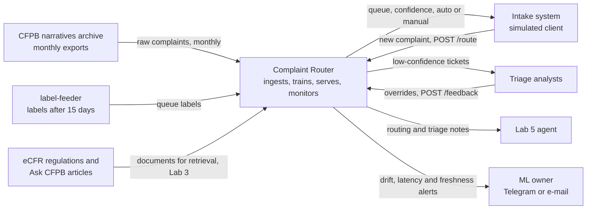
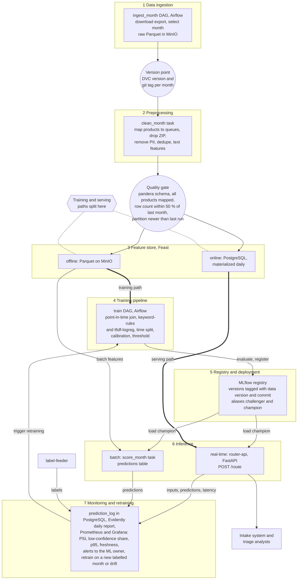
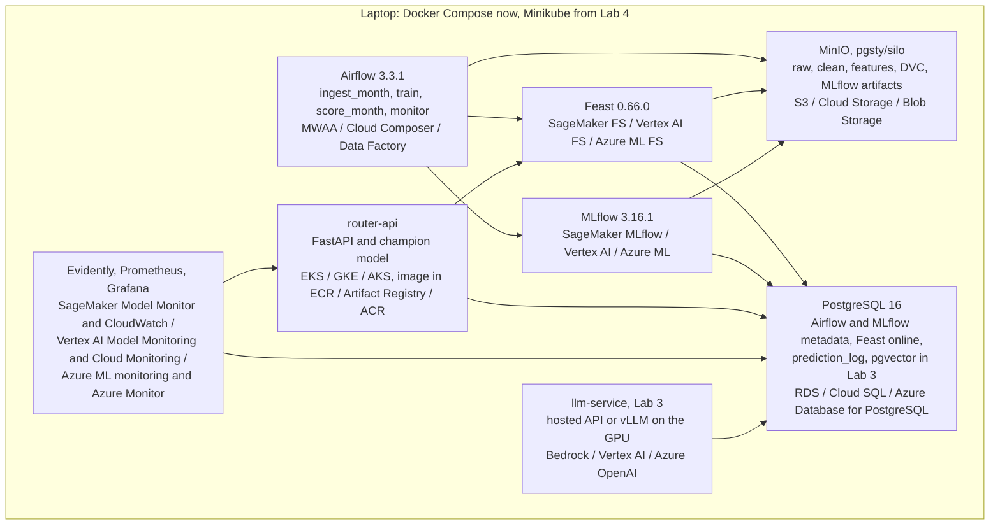

# Complaint Router: design document

Author: Yuliia Martynova. Course: KSE Introduction to MLOps and ML System Design. Status: Lab 1, v0.1. Date: 2026-10-19.

Statements marked "Assumption:" are numbers or decisions I use until a later lab measures them. Component names in `code` style are the same in the text, in section 6.2 and in the diagrams.

---

## 1 Overview

Financial companies receive consumer complaints as free text and have to send each one to the product team that can resolve it. Manual triage is slow and inconsistent, and a misrouted complaint loses days while it moves between teams. Complaint Router reads a complaint at intake and returns one of nine product queues with a confidence score; confident cases are routed automatically and the rest go to a human triage desk. The model is trained on the CFPB Consumer Complaint Database narratives archive (December 2011 to August 2026), retrained on each new monthly batch and monitored for drift. The goal is that most complaints reach the right team without manual work, and that a change in what people complain about is noticed before routing quality drops.

## 2 Motivation

A notebook can show once that a classifier separates complaints by product. In production the data keeps changing. Credit reporting grew to about 88 % of all CFPB complaints in 2025. Among published narratives its share was 75 % over 2023–2025 (58–81 % in every month from September 2024 to December 2025) and then fell to about 4 % in January 2026, when the number of narratives also dropped from 56–173 k to 10–22 k per month. Product names change over time and new scam patterns appear. The model therefore has to be retrained on new periods, compared with the production model, promoted under control and monitored while it serves. This needs a pipeline, a model registry, a service and monitoring.

Who uses the predictions:
- The intake or ticketing system of a complaint desk. In this course it is a client script, and in Lab 5 an agent. It calls `router-api` once per new complaint and uses the returned queue to place the ticket.
- Triage analysts. For low-confidence tickets they see the predicted queue and confidence in the manual queue and confirm or correct it.

How often. Assumption: traffic similar to CFPB intake in 2026, which was 497 000–672 000 complaints per month in January–August 2026 (about 600 000 on average, counted in the archive). That is about 20 000 per day, or 0.23 requests per second on average, with peaks about 10 times higher during business hours. The course demo runs far below this; the design budgets for 10 requests per second.

What happens when a prediction is wrong:
- Wrong queue with high confidence. The ticket goes to a team that cannot resolve it and has to be reassigned by hand, while the 15-day company response window keeps running. This is the expensive error, so the confidence threshold is tuned against it (sections 3 and 5.4).
- Low confidence. The ticket goes to manual triage. This is slower but safe and is the intended fallback.
- Service unavailable. The intake system sends everything to manual triage. Nothing is lost; only the automation rate drops.

## 3 Success metrics

| Layer | Metric | Target | Type | Notes |
|---|---|---|---|---|
| Business | Automation rate: share of complaints routed automatically (confidence ≥ threshold) while misrouting among them stays ≤ 5 % | ≥ 70 % | Optimizing: the threshold is chosen to maximize it under the 5 % limit | Assumption: targets are not based on a real desk. Measured offline on the test period in Lab 2 and on delayed labels in Lab 4. |
| Business (secondary) | Analyst hours saved per month = auto-routed tickets × 2 min | reported only | Reported | Assumption: one manual routing decision takes 2 minutes. |
| Model | Macro-F1 over the 9 queues on the test period | ≥ 0.75 and ≥ baseline + 0.15 | Satisficing (promotion gate, 5.4) | Assumption: 0.75 is a guess until the Lab 2 baseline is measured; the baseline + 0.15 rule is the real gate. |
| Model (guard) | Recall per queue | no queue below 0.55 | Satisficing | Keeps small queues such as student loans from being ignored. |
| System | p95 latency of `POST /route` at the service | ≤ 300 ms | Satisficing | Assumption: low enough for a web form to call it synchronously. |
| System | Availability of `router-api` during the demo | ≥ 99 % of health checks pass | Satisficing | Measured with probes in Lab 4. |
| System | Age of the newest `company_*` features in the online store | ≤ 26 h | Satisficing | Daily materialization plus 2 h margin. |

## 4 Requirements and constraints

### Functional requirements

| # | Requirement |
|---|---|
| F1 | Input: `POST /route` with JSON `{complaint_id, narrative, company, state, tags, date_received}`. `narrative` is required and must be 20–20 000 characters. 2 387 of the 3.85 M archive narratives (0.06 %) are outside this range; such requests get `422` and the caller sends them to manual triage. |
| F2 | Output: `{complaint_id, queue, confidence, top3: [{queue, p}], route: "auto" \| "manual", model_version, request_id}`. `route` is `auto` when `confidence ≥ threshold`; the threshold is stored with the model in the registry. |
| F3 | Callers: the intake system and the Lab 5 agent, each with its own API key. No anonymous access. |
| F4 | `POST /feedback` `{complaint_id, true_queue, source: "analyst" \| "label_batch"}` records a correction or a delayed label. |
| F5 | `GET /health` (liveness) and `GET /ready` (model loaded, feature store reachable). |
| F6 | A batch job scores a whole monthly partition and writes the results to the `predictions` table. |
| F7 | Every prediction is logged with the input hash, the features used, the model version and the latency (6.6). |
| F8 | Retraining runs on a schedule for each new monthly batch and registers a candidate model. Promotion to `champion` is done by a person (5.5). |

### Non-functional requirements

| Category | Requirement | Number or assumption |
|---|---|---|
| Freshness | Predictions are computed from the request text at request time. Company features in the online store are refreshed daily. The model is retrained when a new monthly batch arrives. | Online features ≤ 26 h old; model trained on data at most 45 days older than the latest batch. Assumption: monthly retraining is enough because the complaint mix changes over months, not hours. |
| Latency and throughput | Synchronous inference on CPU. | p95 ≤ 300 ms and p99 ≤ 800 ms at 10 requests/s. Batch scoring of one month (≤ 175 k narratives; the largest month is 2025-01 with 172 937, 2026 months have 10–22 k) ≤ 30 min on the laptop. Assumption: 10 requests/s is about 43 times the 2026 average and covers business-hour peaks. |
| Availability and fallback | If `router-api` is down, takes longer than 1 s or returns 5xx, the caller sends the ticket to manual triage. If the online feature store is unavailable, the service uses text features only and returns `degraded: true`. | ≥ 99 % during the demo. Tickets are never dropped. |
| Reproducibility | Any registered model can be rebuilt from the git commit, the DVC data version and the config. The environment is pinned by `uv.lock`, images are tagged with the commit SHA, random seeds are fixed. | One command per model (`make train DATA_VERSION=...`), Lab 2. |
| Adaptability | New data arrives as a new monthly partition through the ingestion DAG. New models are registered in MLflow with the alias `challenger` and compared with `champion` on the latest labelled month. Changing the model only moves the alias; the image is not rebuilt. A new queue needs a change in `configs/queues.yaml` and a retrain. | Candidate model within 1 day after a batch arrives. |
| Observability without ground truth | Labels arrive about 15 days late (5.2). Until then the system tracks input drift (text length, out-of-vocabulary rate, company mix), prediction drift (PSI of the queue distribution), confidence, the analyst override rate and service metrics. | Alert when PSI of predicted queues > 0.2 or the low-confidence share > 30 % over 7 days. Macro-F1 on labelled data is computed weekly once labels arrive. |
| Cost and resources | Everything runs on one laptop: 32 GB RAM, Intel i7-10750H, NVIDIA GTX 1650 Ti with 4 GB (measured). Minikube gets 4 GB with the docker driver. The GPU is only used for the optional local LLM in Lab 3. Cloud estimate in 6.7. | Training ≤ 15 min on CPU and ≤ 8 GB RAM. Raw data ≤ 10 GB on disk (the full archive is 1.37 GB zipped, 9.3 GB as CSV). LLM spend ≤ $10 per month. |

### 4.1 In scope and out of scope

In scope:
- Routing one complaint narrative to one of 9 product queues, online and in batch.
- Monthly retraining on a replay of the CFPB archive, a registry with manual promotion, drift monitoring and alerts.
- Lab 3: an LLM assistant that retrieves the relevant regulation or CFPB guidance for a routed complaint and drafts a triage note with citations.
- Lab 5: an agent that uses the routing API and the retrieval component as tools.

Out of scope:
- Routing to `issue` or `sub-issue` (80+ values that change over time).
- Predicting the company response, relief or dispute outcome.
- A real consumer product, integration with a real ticketing system, streaming ingestion.
- Complaints in languages other than English.
- Judging whether a complaint is true. Near-duplicate detection is used only as a data quality signal (6.9).

---

## 5 Methodology

### 5.1 Problem statement

Chosen framing: single-label multi-class text classification with a reject option. The input is the narrative plus a few intake fields; the output is a probability distribution over 9 queues. The top queue is used when its probability is above the threshold; otherwise the complaint goes to manual triage. The threshold sets the trade-off between precision and automation from section 3.

The 9 queues group the CFPB `Product` values. The mapping will be stored in `configs/queues.yaml` (Lab 2):

| Queue | CFPB products |
|---|---|
| `CREDIT_REPORTING` | Credit reporting; Credit reporting, credit repair services, or other personal consumer reports; Credit reporting or other personal consumer reports |
| `DEBT_COLLECTION` | Debt collection |
| `BANKING` | Checking or savings account; Bank account or service |
| `CARDS` | Credit card; Prepaid card; Credit card or prepaid card |
| `MORTGAGE` | Mortgage |
| `STUDENT_LOAN` | Student loan |
| `VEHICLE_LOAN` | Vehicle loan or lease |
| `CONSUMER_LOAN` | Payday loan; Payday loan, title loan, or personal loan; Payday loan, title loan, personal loan, or advance loan; Consumer Loan; Debt or credit management |
| `PAYMENTS` | Money transfer, virtual currency, or money service; Money transfers; Virtual currency |

The CFPB renamed products over the years. The archive has 21 distinct `Product` values (checked in all files), and 20 of them map to a queue. The remaining value, `Other financial service`, has 292 narratives, all from 2015–2017, outside the training window. It is put in a `drop` list in `configs/queues.yaml`. The quality gate fails on any value that is neither mapped nor in the `drop` list.

Rejected framing: hierarchical classification down to `issue`. It would route more precisely, but the issue list has dozens of values, many with only a few hundred examples, and it changes when the CFPB revises its forms. Labels would be sparse and inconsistent across the time split, and the evaluation would measure taxonomy changes more than model quality. A triage desk needs the product level first.

### 5.2 Data

Source: the CFPB Consumer Complaint Database narratives archive in the FOIA reading room on consumerfinance.gov. It covers complaints received from 1 December 2011 to 14 August 2026 and consists of 21 zipped CSV exports: multi-month files of 3 to 77 months up to October 2024, two-month files from November 2024 and monthly files from March 2026. The archive is 1.37 GB zipped and 9.3 GB unzipped, with 17.5 M rows, of which 3 851 415 have a narrative (measured). Rows without a narrative are removed. On 14 August 2026 the CFPB stopped publishing narratives, so the archive will not grow. The data is US government public data.

Fields used (checked against all 21 files): `Date received`, `Product` (label), `Consumer complaint narrative` (text), `Company`, `State`, `Tags`, `Complaint ID`. The archive has 16 columns, the same in every file, and no `Consumer consent provided?` column, so rows are kept when the narrative is not empty. Dropped: `ZIP code` (privacy, 6.5) and `Submitted via`, which is `Web` for all 3.85 M narratives. Not used as features because they are unknown at intake (leakage): `Sub-product`, `Issue`, `Sub-issue`, `Company response to consumer`, `Company public response`, `Timely response?`, `Date sent to company`.

Arrival pattern. The CFPB published complaints daily: a complaint appeared after the company responded or after 15 days, and its narrative after the company's public response or after 60 days. In this system the archive is replayed in monthly batches: the ingestion DAG uses a simulated date and loads the calendar month `YYYY-MM` that has just ended, by `Date received`.

Labels and delay. The label is the product the complaint was filed under. In the archive it is in the same row as the narrative, but in the simulated system the routing decision is made at intake and the correct queue is known only after the team has handled the ticket. Assumption: labels arrive 15 days after `date_received`, the CFPB company response window. The `label-feeder` task in the ingestion DAG releases a label once `date_received + 15 days` is before the simulated date. During those 15 days Lab 4 monitors proxy signals (section 4, observability).

Serving time versus training time:

| Data | At serving time | At training time |
|---|---|---|
| Narrative, company, state, tags, date | In the request | In the archive |
| Company aggregates (complaint counts, product mix) | From the online store, up to 26 h old | From the offline store with a point-in-time join |
| Product label | Not available (it is the prediction) | Available |
| Issue, company response, timeliness | Not available | Available but excluded to avoid leakage |

Volume and training window. The archive has 3 851 415 narratives, 2 645 239 of them received from 2023-01-01. Assumption: training uses complaints from 2023-01-01, stratified and downsampled to at most 300 000 rows per run so that a run fits on the laptop. Raw monthly partitions are stored in full.

Data checklist:

| Item | Justification |
|---|---|
| Time axis | Every row has `Date received` with day precision. Batches are calendar months: the archive covers 177 months (2011-12 to 2026-08), 138 of which contain narratives (2015-03 to 2026-07). The archive ended on 2026-08-14, so "the next month" comes from replaying it with a simulated clock. The cost is that there is no truly unseen future; August 2026 has 1 narrative and is dropped. The archive already contains real drift: product renames and the January 2026 break, when the credit-reporting share of narratives fell from 58–81 % per month (September 2024 to December 2025) to about 4 %, and monthly volume fell from 56–173 k to 10–22 k. Lab 4 can replay these shifts as well as injected ones. |
| History for a held-out period | Narratives run from 2015-03-19 to July 2026, about 11.4 years. Training: 2023-01 to 2025-12 (2 523 845 narratives). Validation for model selection, calibration and threshold: 2026-01 to 2026-03 (55 991). Test: 2026-04 to 2026-07 (65 402), four full months not used for any decision before the Lab 2 report. Training and test are on opposite sides of the January 2026 break: credit reporting is 75.0 % of training narratives, 3.9 % of validation and 4.2 % of test (see 5.4). |
| Labels with a known delay | The label is the product category. In the simulation it arrives 15 days after the complaint (assumption based on the 15-day response window). Labels for a month are complete 15 days after the month ends, which is when the monthly retrain runs. |
| Text or corpus | The task is text classification on the narrative. For Lab 3 retrieval the corpus is the CFPB "Ask CFPB" consumer articles and the eCFR text of the regulations behind each queue: Regulation V (credit reporting), Regulation F (debt collection), Regulation E (electronic transfers), Regulation Z (cards, mortgages, loans), Regulation X (mortgage servicing), Regulation DD (deposit accounts). Both are US government public text. |

### 5.3 Techniques

Baseline: `keyword-rules`. A hand-written list of 10–20 phrases per queue ("credit report", "collector", "escrow", "Navient", "Zelle", ...) scored by the number of matches. Ties and complaints with no matches go to the most frequent queue in the training window. It needs no training, analysts can understand it, and the model has to beat it by at least 0.15 macro-F1 (section 3).

Candidate: `tfidf-logreg`. A scikit-learn pipeline: TF-IDF on word 1–2-grams (min_df 5, sublinear tf) and character 3–5-grams on the first 2 000 characters, one-hot categorical features and scaled numeric features, then multinomial logistic regression with `class_weight="balanced"`. Probabilities are calibrated on the validation period (isotonic). It trains on CPU in minutes, predicts in a few milliseconds and gives probabilities that can be thresholded. Assumption: a fine-tuned DistilBERT (fits on the 4 GB GPU with small batches and fp16) is tried later only if `tfidf-logreg` misses the model target.

Features and their source at serving time:

| Feature | Training source | Serving source |
|---|---|---|
| `narrative_tfidf` (word and character n-grams) | Archive narrative, transformed by the fitted pipeline | Request `narrative`, transformed by the same pipeline object stored in the model artifact |
| `narrative_len_chars`, `has_dollar_amount`, `redaction_ratio` (share of `XXXX` tokens) | Computed from the archive narrative by `features/text.py` | Computed from the request narrative by the same function inside `router-api` |
| `state` (one-hot, 50 states and other) | Archive column | Request field |
| `tag_older_american`, `tag_servicemember` | Archive `Tags` | Request `tags` |
| `company_complaints_30d` | Feast offline store (Parquet on MinIO), point-in-time join on `company` and `date_received` | Feast online store (PostgreSQL), materialized daily by Airflow, up to 26 h old |
| `company_top_queue_share_90d` (share of the company's complaints in its most frequent queue over 90 days, labelled data only) | Feast offline, point-in-time join, only labels older than 15 days at the event date | Feast online, same definition, materialized daily |
| `company_known` (company exists in the feature store) | Set during the join | Set during the lookup; an unknown company gets default values and the flag |

`company_complaints_30d` and `company_top_queue_share_90d` come from different sources at training and serving time. This is where training-serving skew can appear (data flow diagram in 6.1, risks in 6.9).

### 5.4 Experimentation and validation

Split by time, not at random. Complaints arrive over time and their wording and mix change. A random split would let the model see future vocabulary, put copies of the same template complaint on both sides and leak labels through the company aggregates. Splits: training 2023-01 to 2025-12, validation 2026-01 to 2026-03, test 2026-04 to 2026-07 (5.2). In addition, a rolling-origin backtest with three folds: each fold trains on everything before month *m* and tests on month *m* (*m* = 2026-01, 2026-02, 2026-03); results are reported as mean and spread. Near-duplicate narratives (MinHash similarity > 0.9) are kept on one side of each split only. This matters because 41 % of narratives received from 2023 (1 093 632 of 2 645 239) are exact copies of another narrative (measured).

The January 2026 break. The class mix changes sharply between training and the later periods: `CREDIT_REPORTING` is 75.0 % of training narratives but 3.9 % of validation and 4.2 % of test (measured; the archive does not explain the cause). This affects validation in three ways. Calibration and the threshold are fitted on the validation period, which is already after the break. Macro-F1 and per-queue recall are used as gates instead of accuracy, so predicting the formerly dominant class is not rewarded. The champion and challenger are always compared on the latest labelled month, not on the training period.

Offline metrics. Main metric: macro-F1 over the 9 queues. Also: recall per queue, weighted F1 and the automation rate at ≤ 5 % misrouting. The threshold is chosen on validation and applied unchanged to test, which gives the offline estimate of the business metric.

Comparing a new model with the current one. Each retrain registers a version with the alias `challenger`. A comparison task evaluates `champion` and `challenger` on the same latest labelled month and logs both runs to MLflow. The challenger can be promoted if its macro-F1 ≥ champion − 0.005, its automation rate at ≤ 5 % misrouting is not lower than the champion's, no queue loses more than 3 percentage points of recall, and p95 latency in a local load test is ≤ 300 ms. From Lab 4, a challenger that passes runs for 7 days in shadow mode (scores are logged but not returned) before a person promotes it (5.5).

### 5.5 Human in the loop

| Event | Who | Action |
|---|---|---|
| Drift alert (6.6) | ML owner (me) | Within 1 business day opens the Evidently report linked in the alert and decides whether it is an expected seasonal change, a data problem to fix in ingestion, or a real shift that needs a retrain. The decision is written in the alert ticket. |
| Model promotion | ML owner | Reviews the champion/challenger comparison in MLflow and the shadow-mode report, then moves the `champion` alias to the new version manually. The pipeline can set `challenger` but never `champion`. |
| Rollback | ML owner | Moves `champion` back to the previous version. `router-api` reloads the model within 5 minutes after the alias changes. |
| Prediction override | Triage analyst | In the manual queue sees the predicted queue, top 3 and confidence, then confirms or picks another queue. The choice is sent to `POST /feedback` with `source: analyst`. Overrides become labels for the next retrain and feed the override-rate metric. |
| Threshold change | ML owner together with the triage desk lead (assumed role) | The threshold changes the desk's workload, so it is agreed with the desk and stored as a parameter of the model version. |

---

## 6 Implementation

### 6.1 High-level design

#### System context

The system is one box; everything around it belongs to someone else. `label-feeder` is drawn outside because it stands for the label source, the team that resolved the ticket. In this course it is an Airflow task that releases archive labels with a 15-day delay.

#### Data flow

The three required marks:
- Version point: between ingestion and preprocessing. Each raw monthly partition gets a DVC version and a git tag.
- Quality gate: between preprocessing and the feature store. A failed check stops the DAG and nothing reaches Feast.
- Training and serving split: at the offline and online sides of Feast. Training reads point-in-time history from the offline store, `router-api` reads the latest values from the online store, and the batch scorer reads the offline store. Training-serving skew can appear here (stale or differently computed `company_*` values) and in text preprocessing if `router-api` did not use the same packaged pipeline.

#### Deployment, first draft

First draft; Lab 4 replaces it with the real Minikube topology. Cloud equivalents are listed as AWS / GCP / Azure.

### 6.2 Infra

The local stack uses the course reference versions. For each component the table gives the managed service I would use instead. These are all the components of the system, and the diagrams use the same names.

| Component | Local | AWS | GCP | Azure |
|---|---|---|---|---|
| `MinIO`: object storage for raw, clean and feature Parquet, DVC remote, MLflow artifacts | `pgsty/silo:RELEASE.2026-09-16T00-00-00Z` | Amazon S3 | Cloud Storage | Blob Storage |
| `DVC`: data versioning with a remote on MinIO | DVC 3.67.1, dvc-s3 3.3.0 | S3 remote | GCS remote | Azure Blob remote |
| `PostgreSQL`: Airflow and MLflow backend, Feast online store, `prediction_log`, `predictions`, later pgvector | PostgreSQL 16 | Amazon RDS for PostgreSQL | Cloud SQL | Azure Database for PostgreSQL |
| `Airflow`: orchestrator with the `ingest_month`, `train`, `score_month` and `monitor` DAGs and the `label-feeder` task | Apache Airflow 3.3.1, LocalExecutor | Amazon MWAA | Cloud Composer | Azure Data Factory |
| `MLflow`: experiment tracking and model registry | MLflow 3.16.1, PostgreSQL backend, MinIO artifacts | SageMaker with MLflow | Vertex AI Experiments and Model Registry | Azure ML with MLflow |
| `Feast`: feature store, offline on MinIO Parquet, online on PostgreSQL | Feast 0.66.0 | SageMaker Feature Store | Vertex AI Feature Store | Azure ML managed feature store |
| `router-api`: FastAPI service with the champion model loaded from MLflow by alias; `/route`, `/feedback`, `/health`, `/ready` | Container in Docker Compose, on Minikube from Lab 4 | EKS (or a SageMaker endpoint) | GKE (or a Vertex AI endpoint) | AKS (or an Azure ML online endpoint) |
| Container registry for the `router-api` image | Minikube built-in registry | Amazon ECR | Artifact Registry | Azure Container Registry |
| Kubernetes cluster for `router-api` (Lab 4) | Minikube 1.33.1, Kubernetes 1.30.0, docker driver, 4 GB | Amazon EKS | GKE | AKS |
| `Evidently`: data and prediction drift reports | Evidently | SageMaker Model Monitor | Vertex AI Model Monitoring | Azure ML model monitoring |
| `Prometheus` and `Grafana`: service metrics, dashboards, alerts | Prometheus, Grafana | Amazon CloudWatch | Cloud Monitoring | Azure Monitor |
| Vector store for Lab 3 retrieval | pgvector 0.8.7 (`pgvector/pgvector:pg16`) | OpenSearch Serverless vector search | Vertex AI Vector Search | Azure AI Search |
| `llm-service`: LLM inference for Lab 3 | Assumption: a hosted OpenAI-compatible API by default; locally vLLM 0.30.0 with an instruct model of up to 1.5 B parameters on the GTX 1650 Ti | Amazon Bedrock | Vertex AI generative AI | Azure OpenAI |

Libraries that run inside these components and have no separate cloud service: scikit-learn (model), pandera (quality gate checks in an Airflow task), datasketch (MinHash deduplication), FastAPI and uvicorn (`router-api`).

Assumption: until Lab 4 the services run with Docker Compose on the laptop. Minikube gets 4 GB, and only `router-api` and monitoring move into it.

### 6.3 Performance

Batch or online: online for routing, batch for backfill and monitoring. The intake system needs the queue when the complaint is submitted, so ticket placement cannot wait for a nightly job; `router-api` scores one complaint per request. The batch job `score_month` rescores a whole month for backfill, champion/challenger comparison and drift reports, where completeness matters more than latency.

| Path | Budget | How it is met |
|---|---|---|
| `POST /route` at the service | p95 ≤ 300 ms, p99 ≤ 800 ms | TF-IDF with logistic regression predicts in about 1–10 ms on CPU (assumption, measured in Lab 4). The Feast online lookup takes ≤ 30 ms (one key in PostgreSQL). The rest covers JSON parsing, asynchronous logging and network. |
| Throughput | 10 requests/s, 1 replica | One uvicorn worker per CPU core; load-tested in Lab 4 with locust or hey. |
| Online feature materialization | daily, ≤ 10 min | Only the `company` entity, about 4 600 companies with narratives since 2023. |
| `score_month` batch | ≤ 30 min for ≤ 175 k rows (largest month: 2025-01, 172 937) | Vectorized `predict_proba` in chunks of 50 k. |
| Retraining (`train` DAG) | ≤ 15 min on CPU, ≤ 8 GB RAM | At most 300 k training rows (5.2), sparse matrices. |
| LLM triage note (Lab 3, asynchronous) | p95 ≤ 5 s | Called after routing and never blocks `/route`. |

### 6.4 Security

- Secrets are kept locally in `.env`, which is ignored by git (the template is `.env.example` and contains no values). From Lab 4 they are Kubernetes Secrets; in the cloud they would be in AWS Secrets Manager, GCP Secret Manager or Azure Key Vault. Secrets: MinIO root credentials, PostgreSQL passwords, the router API keys, the LLM API key and the alert bot token.
- `POST /route` and `POST /feedback` require an `X-API-Key` header. There are two keys, one for the intake system and one for the Lab 5 agent. `/health` and `/ready` are reachable only inside the cluster. The MLflow, Airflow and Grafana interfaces listen on localhost only, and only the ML owner promotes models.
- Dependencies are pinned by `uv.lock`, container images by tag (and by digest from Lab 4). CI runs on every push.

### 6.5 Data privacy

- Personal data. The CFPB published narratives only with the consumer's consent and replaced direct identifiers such as names, account numbers and SSNs with `XXXX`; 68 % of archive narratives contain at least one `XXXX`. Remaining quasi-identifiers: ZIP code, state, tags (Older American, Servicemember), company, dates, and details in the free text that redaction may have missed.
- Handling. `ZIP code` is dropped during preprocessing. A regex filter removes e-mail addresses, phone numbers, long digit sequences and URLs before text reaches the clean layer. `state` and tags are kept as features. `prediction_log` stores only a hash and the length of the narrative, not the text.
- Retention. Raw partitions are kept until the end of the course and the defense, until 2027-02-28, and then deleted from MinIO and the DVC remote, together with the clean and feature layers. Prediction logs are kept for 90 days.
- Use. The data is public government data used for coursework. Narratives are unverified and one-sided, which is the reason the CFPB gave for stopping their publication; the system routes complaints and does not judge companies.

### 6.6 Monitoring and alarms

First draft; Lab 4 implements it.

Logged for every request in `prediction_log` (PostgreSQL): `request_id`, timestamp, simulated date, `complaint_id`, narrative hash and length, feature values, the `degraded` flag, model version and alias, predicted queue, top 3 probabilities, route (`auto` or `manual`) and latency. Labels from `label-feeder` and overrides from `/feedback` are joined later.

| Metric | Source and window | Alert condition | Severity |
|---|---|---|---|
| 5xx error rate of `router-api` | Prometheus, 5 min | > 1 % for 10 min | page |
| p95 latency of `/route` | Prometheus, 5 min | > 300 ms for 10 min | page |
| Readiness | Kubernetes probes | a pod not ready for > 5 min | page |
| Stale partition: the latest `ingest_month` run loaded a partition that is not newer than the previous run, or no new partition for 35 days of simulated time | Airflow task `check_freshness`, Grafana | any occurrence | page |
| Age of online `company_*` features | Feast metadata, hourly | > 26 h | warn |
| Row count of a new month compared with the previous month | quality gate | outside ±50 %, the DAG fails | page |
| PSI of the predicted queue distribution against the training reference | Evidently, daily over the last 7 days | > 0.2 warn, > 0.3 page | warn / page |
| Input drift: narrative length, out-of-vocabulary rate, share of unknown companies | Evidently, daily | drift in at least 2 of 3 | warn |
| Share of low-confidence (manual) routes | Prometheus and Evidently, 7 days | > 30 % | warn |
| Analyst override rate on auto-routed tickets | PostgreSQL query, weekly | > 5 % (the business limit) | page |
| Macro-F1 on labelled data (labels arrive after 15 days) | `monitor` DAG, weekly | drop of more than 0.05 against the reference month | page, then a retrain decision |

Alerts go from Grafana to the ML owner (me) by Telegram bot or e-mail. Each alert links the Grafana panel and the latest Evidently report. Warnings are collected into a daily digest.

Retraining runs on a schedule 15 days after a month ends, when its labels are complete. It also runs when the macro-F1 alert fires or when the ML owner decides so after a drift alert (5.5).

### 6.7 Cost

Estimated monthly cost of running the same system on AWS in us-east-1, on demand, 730 hours per month, always on. Everything actually runs locally; this prices the cloud column of 6.2. Rates are from the AWS pricing pages and the AWS Pricing Calculator; rows marked "Assumption" use sizes I chose.

| Component | AWS service and size | Calculation | USD per month |
|---|---|---|---|
| Kubernetes control plane | EKS, standard support, 1 cluster | 730 h × $0.10 | 73 |
| Kubernetes nodes | EC2 2 × t3.medium (assumption: about $0.042 per hour each) | 2 × 730 × 0.042 | 61 |
| Orchestrator | MWAA, small environment | 730 h × $0.49 | 358 |
| Tracking and registry | SageMaker with MLflow, small tracking server | 730 h × $0.60 | 438 |
| Database | RDS PostgreSQL db.t4g.micro with 20 GB gp3 (assumption: about $0.016 per hour and $0.115 per GB) | 12 + 2 | 14 |
| Object storage | S3 Standard, assumption: 50 GB plus requests | 50 × $0.023 + about 1 | 2 |
| Container registry | ECR, 2 GB | 2 × $0.10 | 0.2 |
| Feature store | SageMaker Feature Store, assumption: about 4 600 companies, about 1 M reads | | 5 |
| Model monitoring | SageMaker Model Monitor, assumption: daily 15-minute job on ml.m5.large | 30 × 0.25 h × about $0.12 | 1 |
| Metrics, logs, alarms | CloudWatch, assumption: 5 GB of logs, 20 metrics, 10 alarms | | 10 |
| LLM (Lab 3) | Bedrock, assumption: 5 000 triage notes × 2 000 tokens with a small model | | 5 |
| Total | | | about 970 |

About 82 % of the cost is the two always-on managed services, MWAA and the MLflow server, not compute. Running Airflow and MLflow as pods on the EKS nodes (one more t3.medium) would cost about $200 per month, but then we operate them ourselves. If the estimate were ten times too low, the most likely wrong assumptions are the LLM tokens per note and the request volume; the first thing to relax would be generating the triage note on demand instead of for every ticket.

### 6.8 Integration points

| Party | Direction | Contract |
|---|---|---|
| CFPB narratives archive (data owner: Consumer Financial Protection Bureau) | in | Zipped CSV exports at fixed URLs on consumerfinance.gov with the CFPB complaint field set (5.2). There is no SLA and no new data after 2026-08-14. The files are downloaded once, checksummed and stored in MinIO and DVC, so the system does not depend on the site. Schema changes are caught by the pandera schema at the quality gate: an unknown or missing column fails the run. |
| `label-feeder` (label source, stands for the team that resolved the ticket) | in | Delivers `{complaint_id, true_queue, label_date}` with `label_date = date_received + 15 days`, at most once per complaint, into the `labels` table. |
| Triage analysts | in and out | Receive tickets with `route = manual` together with top 3 and confidence, and send corrections through `POST /feedback`. |
| Intake system (consumer of predictions) | out | Request and response schema from F1 and F2, versioned under `/v1`. p95 ≤ 300 ms. On a timeout over 1 s or a 5xx the caller sends the ticket to manual triage. `model_version` is returned for audit. Breaking changes only in a new `/v2`. |
| Lab 5 agent | out | The same API with its own key, plus the Lab 3 retrieval endpoint, limited to 2 requests per second. |
| eCFR and Ask CFPB (corpus owners for Lab 3) | in | Public text, downloaded once per lab run and versioned with DVC like the raw data. |

### 6.9 Risks and uncertainties

| Risk | Mitigation |
|---|---|
| The source is frozen: no narratives after 2026-08-14, so no truly new data. | Replay the archive with a simulated clock, add synthetic shifts in Lab 4 on top of the real ones, and state in the README that "next month" is a replayed month. |
| Class imbalance and shift: credit reporting is 75 % of the 2023–2025 training narratives and about 4 % from January 2026. 41 % of narratives since 2023 are exact duplicates, which points to template submissions; the CFPB itself raised concerns about abuse of the complaint system in 2026. | `class_weight="balanced"`, the per-queue recall guard (section 3), MinHash duplicate detection with a cap per template, and the duplicate share tracked as a data quality metric. |
| Product renames over the years break the label mapping. | Explicit mapping in `configs/queues.yaml`; the quality gate fails on any unmapped value; the training window starts in 2023. |
| Label noise: consumers can file under the wrong product. | Manually check 200 random complaints in Lab 2 to estimate the noise rate, report metrics with that caveat, and use analyst overrides as better labels. |
| Training-serving skew in `company_*` features (online values up to 26 h old versus point-in-time offline values) or in text preprocessing. | One packaged scikit-learn pipeline for training and `router-api`; feature definitions only in the Feast repository; from Lab 4 a daily comparison of a sample of online and offline values. |
| Selection bias: only consented narratives were published, so the data is not a random sample of complaints. | State this in the README and the model card; do not claim results for complaints without a narrative. |
| Personal data left in the free text. | Regex filter during preprocessing, no narrative text in logs, retention deadline (6.5). |
| Laptop resources: Minikube with 4 GB next to Airflow, PostgreSQL, MinIO and MLflow; the GPU has only 4 GB. | Docker Compose for the data stack and Minikube only for serving; at most 300 k training rows; in Lab 3 an LLM API by default and local vLLM only with a model up to 1.5 B parameters in fp16. |
| Dataset size: 21 ZIP files, 1.37 GB zipped, 9.3 GB as CSV, 17.5 M rows (measured). | Ingest one export file at a time, keep only 2023 and later, store as Parquet. |

---

## 7 Appendix

### 7.1 Alternatives

| Alternative | Pros | Cons | Decision |
|---|---|---|---|
| Zero-shot LLM classification as the router, with the 9 queue descriptions in the prompt | No training data needed, handles new wording, gives an explanation | 0.5–5 s latency, cost per call, non-deterministic output, hard to calibrate a threshold, model versions outside our control | Rejected as the router because it breaks the 300 ms budget and reproducibility. Used in Lab 3 as an assistant that writes a triage note after routing. |
| Twitter customer support corpus or a synthetic intent dataset (for example Bitext) | Short real chat texts (Twitter), clean labels (synthetic) | Twitter labels are the brand that replied, not a department, and the data covers a short period; synthetic data has no real time axis or drift | Rejected: fails the time axis and label checklist items, while the CFPB archive passes all four. |
| Streaming ingestion with Kafka and Spark | Matches a real daily publication feed | The data comes as monthly files and the source is frozen; two heavy services would not fit in a 4 GB cluster | Rejected: monthly batch ingestion with Airflow matches how the data actually arrives. |
| Fine-tuned DistilBERT as the candidate | Usually higher macro-F1 on text | Slow training on a 4 GB GPU, higher CPU serving latency, harder to reproduce | Deferred: becomes a challenger only if `tfidf-logreg` misses the model target. |
| Random train/test split | Simpler, more training data | Leaks future vocabulary and duplicate templates, overstates quality | Rejected: time-based split (5.4). |

### 7.2 Experiment results

Placeholder, filled in Lab 2: baseline and candidate on the time split, rolling-origin backtest, threshold sweep, data version and commit of each run.

### 7.3 Performance benchmarks

Placeholder, filled in Lab 4: measured p50, p95 and p99 latency and throughput of `router-api` on Minikube, batch scoring time, resource use.

### 7.4 Milestones

| Lab | What it adds |
|---|---|
| Lab 2: data pipelines, versioning, baseline, MLflow | The `ingest_month` DAG loads each replayed month into MinIO under DVC, the quality gate rejects a bad batch on purpose, and `keyword-rules` and `tfidf-logreg` are trained on the time split and registered in MLflow with data version and commit (fills 7.2). |
| Lab 3: LLM baseline and retrieval | `llm-service` with pgvector retrieval over the eCFR regulations and Ask CFPB articles writes a triage note with citations for each routed complaint; evaluated on a labelled question set with retrieval and answer metrics, versioned prompts, and recorded cost and latency. |
| Lab 4: serving on Minikube, monitoring and drift | `router-api` is containerized and deployed on Minikube with health probes; `prediction_log`, Evidently, Prometheus and Grafana implement 6.6; an injected shift triggers an alert that reaches the ML owner (fills 7.3 and replaces the deployment diagram). |
| Lab 5: agentic extension | An agent uses `POST /route`, the retrieval component and the feedback endpoint as tools to handle a complaint end to end, with stored traces and a ten-task evaluation run twice. |
